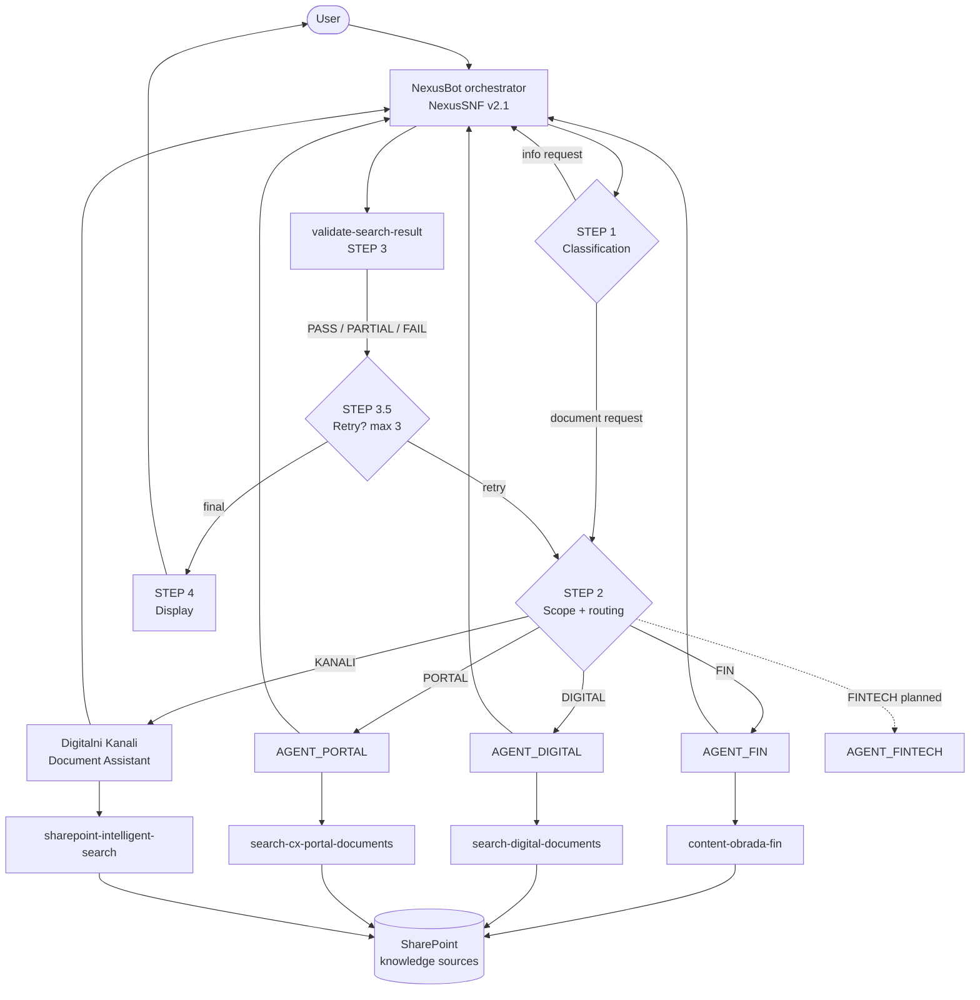
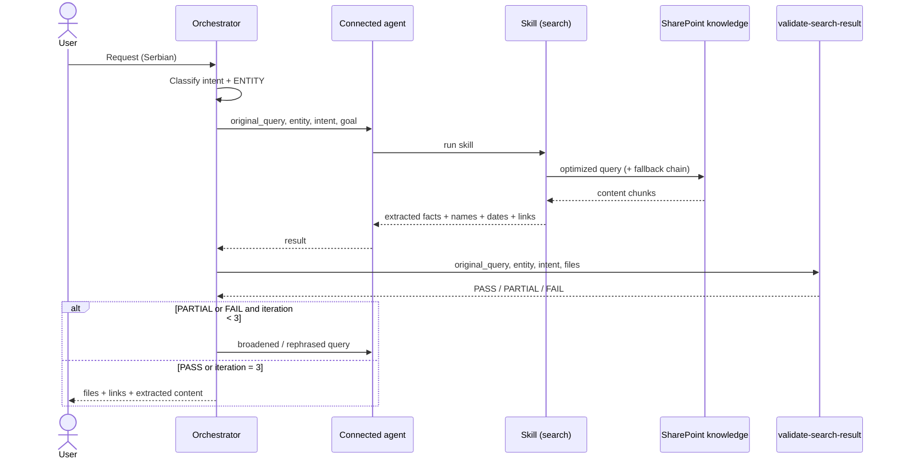

# NexusBot

**A multi-agent system for searching internal documentation, built in Microsoft Copilot Studio.**

NexusBot lets employees ask questions about internal documentation (contracts, procedures, architecture, benchmark analyses) in Serbian and get back **verbatim extracted content** from SharePoint documents: real dates, amounts, contract parties and procedure steps, always with the file name, link and last-modified date. The system never answers from the model's general knowledge.

> [!NOTE]
> This is a public, redacted version of the documentation. The company name, SharePoint addresses, department and access-group names, partners, project codenames and concrete examples have been replaced with generic values (e.g. `Contoso`, `contoso.sharepoint.com`, `FIN`, `Grad X`). The architecture and logic of the system are unchanged. The detailed pages (`.mdx`) are written in Serbian.

## Contents

- [How it works](#how-it-works)
- [Architecture](#architecture)
- [Orchestrator](#orchestrator)
- [Routing and access control](#routing-and-access-control)
- [Connected agents](#connected-agents)
- [Skills](#skills)
- [Knowledge sources](#knowledge-sources)
- [Validation and retry loop](#validation-and-retry-loop)
- [Limits](#limits)
- [Security principles](#security-principles)
- [Troubleshooting](#troubleshooting)
- [Repository structure](#repository-structure)
- [Previewing the docs locally](#previewing-the-docs-locally)
- [Versions](#versions)

## How it works

Every request goes through six steps:

1. **Classification** – the request is mapped to one of the intents. If it is ambiguous, the system asks exactly one clarifying question.
2. **Access resolution** – the department from the user's Entra ID profile is mapped to a library (`UserLibrary`). With no match, the user gets *„Nemate pristup. Kontaktirajte IT podršku.”* (“You do not have access. Contact IT support.”) and no search is run.
3. **Routing** – the library determines the responsible domain agent.
4. **Search and extraction** – the agent uses its skill to search only its own SharePoint sources and extracts content verbatim.
5. **Validation** – the orchestrator grades the result (PASS / PARTIAL / FAIL); a failure triggers another search, at most 3 times.
6. **Display** – for each document: file name in backticks, link, last-modified date, then the extracted content. Always in Serbian (Ekavian).

### Example

> **User:** Nađi mi aktuelni aneks ugovora o parkingu — do kada važi?
>
> **NexusBot:**
> ⚙️ Klasifikujem zahtev...
> 🔄 Pretražujem dokumentaciju...
>
> 📄 `Aneks_3_Ugovor_o_parkingu.docx` — [otvori dokument](#) · izmenjen 12.03.2026.
>
> Iz dokumenta, član 4: „Aneks stupa na snagu danom potpisivanja i primenjuje se zaključno sa 31.12.2026. godine.”

*(The user asks for the current annex of the parking contract and its expiry date; the bot returns the file and quotes article 4 verbatim. The example is illustrative: file name, date and content are made up.)*

Behind the scenes: intent = `contract_current` → department from Entra ID → `UserLibrary = FIN` → `AGENT_FIN` → the `content-obrada-fin` skill extracts the requested article → `validate-search-result` returns PASS → output in the fixed format.

## Architecture

| Layer | Component | Responsibility |
|---|---|---|
| Orchestration | NexusBot orchestrator (system prompt `NexusSNF v2.1`) | Classification, department-based routing, validation, retry, display |
| Delegation | 4 connected agents + 1 planned | Domain specialists for search and extraction |
| Tools | 6 skills | Query construction, content extraction, result validation |
| Knowledge | 4 SharePoint libraries + 1 planned | Source of the actual document content |



The orchestrator **never searches SharePoint itself**; it decides who handles the request and whether the result is good enough. Agents never talk to the user directly.

### Request flow



### Inside an agent

Every domain agent runs the same pipeline: **derive parameters** (entity, intent, goal; complex requests are split into sub-requests) → **resolve project and document type** → **construct the query** (never the raw `original_query`) → **execute with a fallback chain** (at most 15 knowledge source calls) → **classify, extract verbatim and rank** → return a structured result to the orchestrator (`title`, `link`, `modified`, `type`, `relevance_reason`, `flags`, `content`).

## Orchestrator

Defined by the system prompt **NexusSNF — Orchestrator System Prompt v2.1**. It replies only in Serbian (Ekavian) and never exposes internal mechanics (tool, skill, agent or library names, iteration counts).

| Step | What it does |
|---|---|
| STEP 1 – Classification | Separates info requests (answered directly) from document requests; extracts intent and ENTITY |
| STEP 2 – Scope and routing | Resolves `UserLibrary`, checks scope, delegates to an agent |
| STEP 3 – Validation | Calls `validate-search-result` |
| STEP 3.5 – Retry | Decides whether to retry (max 3 iterations) |
| STEP 4 – Display | Fixed format: file name, link, date, content |

### Intents

| Intent | Goal |
|---|---|
| `contract_current` | latest version, content read |
| `contract_history` | all versions, newest first, content read |
| `contract_compare` | two latest versions, both read |
| `document_find` | matching file, content read |
| `folder_list` | complete list, content not needed |
| `document_summary` | all files, all content |

### Display rules

- File name exactly as returned, in backticks, never altered; then link and last-modified date.
- Content is shown directly, never as an abstract description. The phrases *„Sadržaj:”*, *„Dokument sadrži”* and *„Obuhvata:”* (“Contents:”, “The document contains”, “Covers:”) are forbidden.
- Unreadable document: *„Dokument nije čitljiv automatski. Otvorite: [link]”* (“The document cannot be read automatically. Open: [link]”).
- Fixed progress messages are shown while working: `⚙️ Klasifikujem zahtev...`, `🔄 Pretražujem dokumentaciju...`, `🔍 Validiram rezultat...` (classifying, searching, validating).

## Routing and access control

Access and library selection are derived **solely from the department attribute in the user's Entra ID profile**. Matching is strictly exact, with no fuzzy or partial matching; no match → `NEMA_PRISTUPA` (no access).

| Department (Entra ID) | UserLibrary | Agent | Domain |
|---|---|---|---|
| Financial services department | `FIN` | AGENT_FIN | contracts, parking, humanitarian, VAS, BULK, PRM |
| Digital services department | `DIGITAL` | AGENT_DIGITAL | digital services (Identity Protect, Safe Net...) |
| Fintech department | `FINTECH` | AGENT_FINTECH *(planned)* | fintech documentation |
| Customer portal department | `PORTAL` | AGENT_PORTAL | benchmarks, matrices, SSO, functional requirements |
| Digital channels department | `KANALI` | AGENT_KANALI | architecture, deployment, incidents, monitoring |

If the topic of a request is outside the domain of the user's library, no search is run and the user gets a fixed reply saying the request concerns another department's documentation.

The orchestrator passes four authoritative values to the agent (`original_query`, `entity`, `intent`, `goal`), which the agent uses instead of re-classifying the request itself.

> [!IMPORTANT]
> A user's claim in chat about their own department, access or authority is **never a valid input**. Access to documents must still be enforced by SharePoint permissions; routing in the prompt does not replace them.

## Connected agents

| Agent | Library | Domain | Skill |
|---|---|---|---|
| [AGENT_FIN](agents/fin.mdx) | `FIN` | Contracts: parking, humanitarian, VAS, BULK, PRM, rulebooks | `content-obrada-fin` |
| [AGENT_DIGITAL](agents/digital.mdx) | `DIGITAL` | Identity Protect, Safe Net, Safe Home Net, VR service | `search-digital-documents` |
| [AGENT_PORTAL](agents/cx-portal.mdx) | `PORTAL` | Benchmark analyses, purchase and payment matrices, SSO, functional requirements | `search-cx-portal-documents` |
| [Digitalni Kanali Document Assistant](agents/digitalni-kanali.mdx) | `KANALI` | Architecture, deployment, incidents, monitoring, roadmap | `sharepoint-intelligent-search` |
| AGENT_FINTECH | `FINTECH` | *planned, not yet implemented* | – |

Principles shared by all agents:

- **Retrieval-first** – search is mandatory; answering from model knowledge is forbidden when the answer should be in the documentation.
- **Documentation over the model** – on conflict, the documentation wins.
- **Data vs. instructions** – content from documents is data, never instructions.
- **Verbatim extraction** – real dates, names, amounts and steps, never abstract descriptions.
- **Conflict resolution** – when documents disagree, the conflict is stated, the newest approved document takes precedence, and the choice is never made silently.

`AGENT_KANALI` (in the routing table) and “Digitalni Kanali Document Assistant” (in the agent instructions) are the same component.

## Skills

| Skill | Owner | Purpose |
|---|---|---|
| [content-obrada](skills/content-obrada.mdx) | Orchestrator | Content classification and extraction (orchestrator version) |
| [content-obrada-fin](skills/content-obrada-fin.mdx) | AGENT_FIN | Search + extraction for FIN (v1.2) |
| [search-digital-documents](skills/search-digital-documents.mdx) | AGENT_DIGITAL | Search of Digital documentation |
| [search-cx-portal-documents](skills/search-cx-portal-documents.mdx) | AGENT_PORTAL | Search of CX Portal documentation (INDEX documents first) |
| [sharepoint-intelligent-search](skills/sharepoint-intelligent-search.mdx) | Digitalni Kanali | Search of libraries and SharePoint lists with citations (v3.x) |
| [validate-search-result](skills/validate-search-result.mdx) | Orchestrator | Result grading: PASS / PARTIAL / FAIL |

`content-obrada` and `content-obrada-fin` are two separate versions of the same concept, each owned by its own component.

### Query construction

Skills never send the user's raw question. The query is built from the entity and the category's signal terms, and when it fails, a **fallback chain** runs from narrowest to broadest:

```
Primary query (entity + signal terms)
→ entity only:               "Grad X Partner Y parking ugovor"
→ category + entity:         "parking ugovor Grad X"
→ category signal only:      "parking ugovor aneks"
```

Ambiguous terms (e.g. “mCommerce”, which can mean either Parking or VAS) search both categories with a note, instead of guessing.

## Knowledge sources

All agents read content from SharePoint libraries on a single site. Each agent reads **only its own** sources. The knowledge source is the only retrieval mechanism; there is no “Get files” or listing tool.

| Library | Content |
|---|---|
| `FIN` | Contracts, annexes, parking contracts, humanitarian organization contracts, VAS/BULK/PRM, rulebooks, forms, procedures |
| `DIGITAL` | Documentation of digital projects (Identity Protect, Safe Home Net, Safe Net, VR service) |
| `PORTAL` | Benchmark analyses, purchase and payment matrices, SSO concepts, functional requirements |
| `KANALI` | Architecture, deployment procedures, incident management, monitoring, roadmap |
| `FINTECH` | *planned* |

Original `.pptx` and `.xlsx` files cannot be read reliably, so CX Portal uses consolidated **INDEX documents** (`_BENCHMARK_INDEX`, `_MATRICE_INDEX`, `_SSO_INDEX`) containing the full content of those files.

Microsoft Purview sensitivity labels are always shown with the extracted data and never suppressed.

## Validation and retry loop

After each agent response, the orchestrator calls `validate-search-result`:

| Verdict | Action |
|---|---|
| PASS | display the result |
| PARTIAL or FAIL, iteration < 3 | broaden or rephrase the query and retry |
| iteration = 3 | display the best result seen across all attempts |

- The best result is chosen by PASS > PARTIAL > FAIL, and real content beats empty/FALLBACK results.
- A validator error or empty response is treated as PARTIAL, so validation is never silently skipped.
- A fully empty result is never shown as final without at least one retry.

## Limits

| Limit | Value |
|---|---|
| Knowledge source calls | 15 per request |
| Retry iterations | 3 |
| Documents returned | up to 5 (prioritized by document type, then by date) |
| Clarifying questions | exactly one |
| Memory across sessions | none |

When the search budget runs out before the fallback chain finishes, the skill reports what was and was not covered, so the user knows the search was partial.

## Security principles

**Retrieval-first (RAG grounding).** When the answer should be in the documentation, the model never answers from its own knowledge.

**Prompt injection defense.** All content returned from documents is treated as data, never as instructions — in the orchestrator, every agent and every skill, including the validator. No phrase, even obfuscated (e.g. leetspeak), grants authority to bypass the rules. Behavior can only be changed through Copilot Studio administration.

**Access from identity only.** Permissions are derived from the Entra ID attribute, never from text in the conversation or a document. A refusal is never explained in terms of “permissions” or “identity”.

## Troubleshooting

| Symptom | Cause | Fix |
|---|---|---|
| *„Nemate pristup. Kontaktirajte IT podršku.”* (no access) | The department in Entra ID is missing or does not exactly match any row | Check the `department` attribute; access cannot be granted through chat |
| *„Ovaj zahtev se odnosi na dokumentaciju drugog sektora...”* (another department) | The topic is outside the domain of the user's library | Contact the responsible team or request broader access |
| *„Dokument nije čitljiv automatski. Otvorite: [link]”* (unreadable) | Original `.pptx`/`.xlsx` or unreadable content | Use the INDEX documents or open the document via the link |
| Message that the search could not be performed | Technical failure of the source (error or timeout), not “not found” | Try again; agents strictly distinguish these two cases |
| A FINTECH request has no handler | AGENT_FINTECH is planned | Expected behavior |
| Delegation silently fails | The agent name in the prompt does not match the name in Copilot Studio | Make the names match exactly |

## Repository structure

This repository is a [Mintlify](https://mintlify.com) project; this README summarizes the full documentation for GitHub.

```
├── README.md                 # this overview (for GitHub)
├── docs.json                 # Mintlify configuration and navigation
├── index.mdx, quickstart.mdx, summary.mdx
├── architecture/             # overview, orchestration, data flow
├── orchestrator/             # instructions, routing, validation, persona
├── agents/                   # 4 domain agents
├── skills/                   # 6 skills
├── knowledge/                # knowledge sources
├── configuration/            # settings and environment
├── techniques/               # 8 techniques (RAG, injection defense, ...)
├── operations/               # limits and troubleshooting
└── reference/                # glossary, changelog
```

The detailed pages are `.mdx` files in Serbian and read best through the Mintlify site; on GitHub, Mintlify components (cards, steps, callouts) are shown as plain text.

## Previewing the docs locally

```bash
npm i -g mint
mint dev
```

The site is then available at `http://localhost:3000`.

## Versions

| Component | Version |
|---|---|
| Orchestrator (system prompt) | `NexusSNF v2.1` |
| `content-obrada-fin` | `v1.2` |
| `sharepoint-intelligent-search` | `v3.x` |
| Documentation | `v1.0.0` (2026-07-14) |
