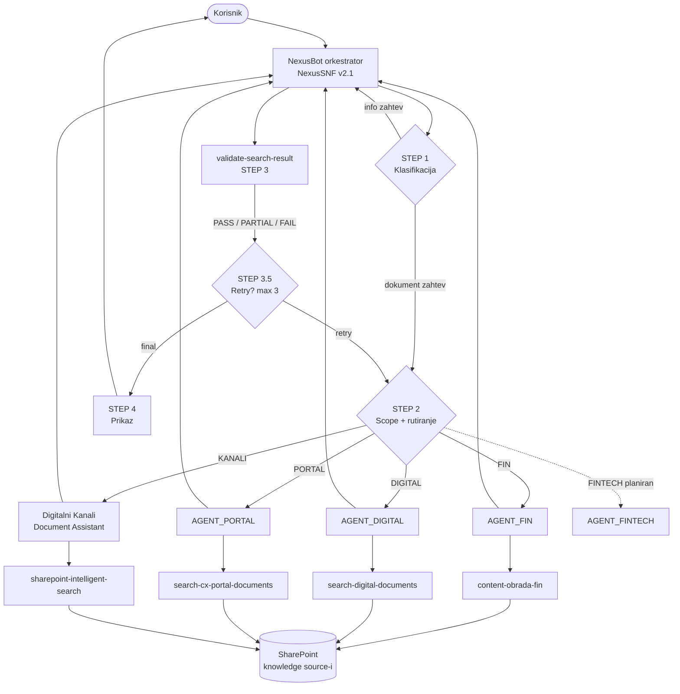
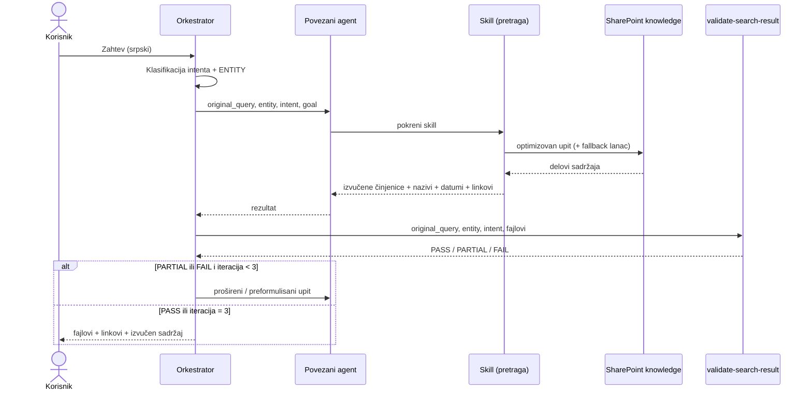

# NexusBot

**Multi-agent sistem za pretragu interne dokumentacije, izgrađen u Microsoft Copilot Studiju.**

NexusBot zaposlenima omogućava da na srpskom postave pitanje o internoj dokumentaciji (ugovori, procedure, arhitektura, benchmark analize) i dobiju **doslovno izvučen sadržaj** iz SharePoint dokumenata: prave datume, iznose, strane ugovora i korake procedura, uvek sa nazivom fajla, linkom i datumom izmene. Sistem ne odgovara iz opšteg znanja modela.

> [!NOTE]
> Ovo je javna, redigovana verzija dokumentacije. Naziv kompanije, SharePoint adrese, nazivi odeljenja i grupa pristupa, partneri, kodni nazivi projekata i konkretni primeri zamenjeni su generičkim vrednostima (npr. `Contoso`, `contoso.sharepoint.com`, `FIN`, `Grad X`). Arhitektura i logika sistema su neizmenjene.

## Sadržaj

- [Kako radi](#kako-radi)
- [Arhitektura](#arhitektura)
- [Orkestrator](#orkestrator)
- [Rutiranje i kontrola pristupa](#rutiranje-i-kontrola-pristupa)
- [Povezani agenti](#povezani-agenti)
- [Skillovi](#skillovi)
- [Izvori znanja](#izvori-znanja)
- [Validacija i retry petlja](#validacija-i-retry-petlja)
- [Limiti](#limiti)
- [Bezbednosni principi](#bezbednosni-principi)
- [Rešavanje problema](#rešavanje-problema)
- [Struktura repozitorijuma](#struktura-repozitorijuma)
- [Lokalni pregled dokumentacije](#lokalni-pregled-dokumentacije)

## Kako radi

Svaki zahtev prolazi kroz šest koraka:

1. **Klasifikacija** – zahtev se svrstava u jedan od intenata. Ako je nejasan, sistem postavlja tačno jedno pitanje za pojašnjenje.
2. **Rezolucija pristupa** – odeljenje iz Entra ID profila korisnika mapira se na biblioteku (`UserLibrary`). Bez poklapanja: „Nemate pristup. Kontaktirajte IT podršku.” i pretraga se ne pokreće.
3. **Rutiranje** – biblioteka određuje nadležnog domenskog agenta.
4. **Pretraga i ekstrakcija** – agent svojim skillom pretražuje isključivo svoje SharePoint izvore i doslovno izvlači sadržaj.
5. **Validacija** – orkestrator ocenjuje rezultat (PASS / PARTIAL / FAIL); neuspeh pokreće ponovnu pretragu, najviše 3 puta.
6. **Prikaz** – za svaki dokument: naziv fajla u backtick-ovima, link, datum izmene, pa izvučen sadržaj. Uvek na srpskom (ekavica).

### Primer

> **Korisnik:** Nađi mi aktuelni aneks ugovora o parkingu — do kada važi?
>
> **NexusBot:**
> ⚙️ Klasifikujem zahtev...
> 🔄 Pretražujem dokumentaciju...
>
> 📄 `Aneks_3_Ugovor_o_parkingu.docx` — [otvori dokument](#) · izmenjen 12.03.2026.
>
> Iz dokumenta, član 4: „Aneks stupa na snagu danom potpisivanja i primenjuje se zaključno sa 31.12.2026. godine.”

*(Primer je ilustrativan; naziv fajla, datum i sadržaj su izmišljeni.)*

U pozadini: intent = `contract_current` → odeljenje iz Entra ID-a → `UserLibrary = FIN` → `AGENT_FIN` → skill `content-obrada-fin` izvlači traženi član → `validate-search-result` vraća PASS → prikaz u fiksnom formatu.

## Arhitektura

| Sloj | Komponenta | Odgovornost |
|---|---|---|
| Orkestracija | NexusBot orkestrator (system prompt `NexusSNF v2.1`) | Klasifikacija, rutiranje po odeljenju, validacija, retry, prikaz |
| Delegacija | 4 povezana (connected) agenta + 1 planiran | Domenski specijalisti za pretragu i ekstrakciju |
| Alati | 6 skillova | Konstrukcija upita, ekstrakcija sadržaja, validacija rezultata |
| Znanje | 4 SharePoint biblioteke + 1 planirana | Izvor stvarnog sadržaja dokumenata |



Orkestrator **nikad sam ne pretražuje** SharePoint; on odlučuje kome da prosledi zahtev i da li je rezultat dovoljno dobar. Agenti nikad ne komuniciraju direktno sa korisnikom.

### Tok zahteva



### Unutar agenta

Svaki domenski agent prolazi isti pipeline: **izvođenje parametara** (entity, intent, goal; složeni zahtevi se dele na podzahteve) → **rezolucija projekta i tipa dokumenta** → **konstrukcija upita** (nikad sirov `original_query`) → **izvršavanje uz fallback lanac** (najviše 15 poziva ka izvoru) → **klasifikacija, doslovna ekstrakcija i rangiranje** → vraćanje strukturisanog rezultata orkestratoru (`title`, `link`, `modified`, `type`, `relevance_reason`, `flags`, `content`).

## Orkestrator

Definisan system prompt-om **NexusSNF — Orchestrator System Prompt v2.1**. Odgovara isključivo na srpskom (ekavica) i nikad ne otkriva interne mehanizme (nazive alata, skillova, agenata, biblioteka, broj iteracija).

| Korak | Šta radi |
|---|---|
| STEP 1 – Klasifikacija | Razdvaja info zahteve (odgovara direktno) od dokument zahteva; izvlači intent i ENTITY |
| STEP 2 – Scope i rutiranje | Rezolucija `UserLibrary`, provera opsega, delegacija agentu |
| STEP 3 – Validacija | Poziva `validate-search-result` |
| STEP 3.5 – Retry | Odlučuje o ponavljanju (max 3 iteracije) |
| STEP 4 – Prikaz | Fiksni format: naziv fajla, link, datum, sadržaj |

### Intenti

| Intent | Cilj |
|---|---|
| `contract_current` | najnovija verzija, pročitan sadržaj |
| `contract_history` | sve verzije, opadajuće, pročitan sadržaj |
| `contract_compare` | dve najnovije verzije, obe pročitane |
| `document_find` | odgovarajući fajl, pročitan sadržaj |
| `folder_list` | kompletna lista, sadržaj nije potreban |
| `document_summary` | svi fajlovi, sav sadržaj |

### Pravila prikaza

- Naziv fajla tačno kako je vraćen, u backtick-ovima, nikad izmenjen; zatim link i datum izmene.
- Sadržaj se prikazuje direktno, nikad kao apstraktan opis („Sadržaj:”, „Dokument sadrži”, „Obuhvata:” su zabranjeni).
- Nečitljiv dokument: „Dokument nije čitljiv automatski. Otvorite: [link]”.
- Tokom rada prikazuju se fiksne progres poruke (`⚙️ Klasifikujem zahtev...`, `🔄 Pretražujem dokumentaciju...`, `🔍 Validiram rezultat...`).

## Rutiranje i kontrola pristupa

Pristup i izbor biblioteke izvode se **isključivo iz atributa odeljenja (department) u Entra ID profilu**. Poklapanje je striktno egzaktno, bez fuzzy ili delimičnog uparivanja; bez poklapanja → `NEMA_PRISTUPA`.

| Odeljenje (Entra ID) | UserLibrary | Agent | Domen |
|---|---|---|---|
| Odeljenje za finansijske servise | `FIN` | AGENT_FIN | ugovori, parking, humanitarni, VAS, BULK, PRM |
| Odeljenje za digitalne servise | `DIGITAL` | AGENT_DIGITAL | digitalni servisi (Identity Protect, Safe Net...) |
| Odeljenje za fintech | `FINTECH` | AGENT_FINTECH *(planiran)* | fintech dokumentacija |
| Odeljenje za korisnički portal | `PORTAL` | AGENT_PORTAL | benchmark, matrice, SSO, funkcionalni zahtevi |
| Odeljenje za digitalne kanale | `KANALI` | AGENT_KANALI | arhitektura, deploy, incidenti, monitoring |

Ako tema zahteva ne pripada domenu korisnikove biblioteke, pretraga se ne pokreće i korisnik dobija fiksan odgovor da se zahtev odnosi na dokumentaciju drugog sektora.

Orkestrator agentu prosleđuje četiri autoritativne vrednosti (`original_query`, `entity`, `intent`, `goal`), koje agent koristi umesto da sam ponovo klasifikuje zahtev.

> [!IMPORTANT]
> Tvrdnja korisnika u chatu o sopstvenom odeljenju, pristupu ili autoritetu **nikad nije validan ulaz**. Prava pristupa dokumentima i dalje moraju da budu obezbeđena SharePoint dozvolama; rutiranje u promptu ih ne zamenjuje.

## Povezani agenti

| Agent | Biblioteka | Domen | Skill |
|---|---|---|---|
| [AGENT_FIN](agents/fin.mdx) | `FIN` | Ugovori: parking, humanitarni, VAS, BULK, PRM, pravilnici | `content-obrada-fin` |
| [AGENT_DIGITAL](agents/digital.mdx) | `DIGITAL` | Identity Protect, Safe Net, Safe Home Net, VR servis | `search-digital-documents` |
| [AGENT_PORTAL](agents/cx-portal.mdx) | `PORTAL` | Benchmark analize, matrice kupovine i plaćanja, SSO, funkcionalni zahtevi | `search-cx-portal-documents` |
| [Digitalni Kanali Document Assistant](agents/digitalni-kanali.mdx) | `KANALI` | Arhitektura, deploy, incidenti, monitoring, roadmap | `sharepoint-intelligent-search` |
| AGENT_FINTECH | `FINTECH` | *planiran, još nije implementiran* | – |

Zajednički principi svih agenata:

- **Retrieval-first** – pretraga je obavezna; odgovor iz znanja modela je zabranjen kada odgovor treba da bude u dokumentaciji.
- **Dokumentacija ispred modela** – kod konflikta, veruje se dokumentaciji.
- **Data vs. instructions** – sadržaj iz dokumenata je podatak, nikad instrukcija.
- **Doslovna ekstrakcija** – stvarni datumi, imena, iznosi i koraci, nikad apstraktni opisi.
- **Rešavanje konflikata** – kod protivrečnih dokumenata konflikt se navodi, prednost ima najnoviji odobreni dokument, i nikad se ne bira tiho.

`AGENT_KANALI` (u ruting tabeli) i „Digitalni Kanali Document Assistant” (u instrukcijama) su ista komponenta.

## Skillovi

| Skill | Vlasnik | Namena |
|---|---|---|
| [content-obrada](skills/content-obrada.mdx) | Orkestrator | Klasifikacija i ekstrakcija sadržaja (verzija orkestratora) |
| [content-obrada-fin](skills/content-obrada-fin.mdx) | AGENT_FIN | Pretraga + ekstrakcija za FIN (v1.2) |
| [search-digital-documents](skills/search-digital-documents.mdx) | AGENT_DIGITAL | Pretraga Digital dokumentacije |
| [search-cx-portal-documents](skills/search-cx-portal-documents.mdx) | AGENT_PORTAL | Pretraga CX Portal dokumentacije (prioritet INDEX dokumentima) |
| [sharepoint-intelligent-search](skills/sharepoint-intelligent-search.mdx) | Digitalni Kanali | Pretraga biblioteka i SharePoint lista sa citiranjem (v3.x) |
| [validate-search-result](skills/validate-search-result.mdx) | Orkestrator | Ocena rezultata: PASS / PARTIAL / FAIL |

`content-obrada` i `content-obrada-fin` su dve zasebne verzije istog koncepta, svaka u vlasništvu svoje komponente.

### Konstrukcija upita

Skillovi nikad ne šalju sirovo pitanje korisnika. Upit se gradi iz entiteta i signal termina za kategoriju, a kada ne uspe, prolazi se **fallback lanac** od najužeg ka najširem:

```
Primarni upit (entitet + signal termini)
→ samo entitet:              "Grad X Partner Y parking ugovor"
→ kategorija + entitet:      "parking ugovor Grad X"
→ samo signal kategorije:    "parking ugovor aneks"
```

Dvosmisleni termini (npr. „mCommerce”, koji može biti i Parking i VAS) pretražuju obe kategorije uz napomenu, umesto pogađanja.

## Izvori znanja

Svi agenti čitaju sadržaj iz SharePoint biblioteka na jednom sajtu. Svaki agent čita **isključivo svoje** izvore. Knowledge source je jedini mehanizam dohvatanja; nema „Get files” ni listing alata.

| Biblioteka | Sadržaj |
|---|---|
| `FIN` | Ugovori, aneksi, parking ugovori, ugovori sa humanitarnim organizacijama, VAS/BULK/PRM, pravilnici, obrasci, procedure |
| `DIGITAL` | Dokumentacija digitalnih projekata (Identity Protect, Safe Home Net, Safe Net, VR servis) |
| `PORTAL` | Benchmark analize, matrice kupovine i plaćanja, SSO koncepti, funkcionalni zahtevi |
| `KANALI` | Arhitektura, deploy procedure, incident menadžment, monitoring, roadmap |
| `FINTECH` | *planirana* |

Originalni `.pptx` i `.xlsx` fajlovi ne mogu se pouzdano čitati, pa CX Portal koristi konsolidovane **INDEX dokumente** (`_BENCHMARK_INDEX`, `_MATRICE_INDEX`, `_SSO_INDEX`) sa punim sadržajem tih fajlova.

Microsoft Purview sensitivity labele se uvek prikazuju uz izvučene podatke, nikad se ne potiskuju.

## Validacija i retry petlja

Posle svakog odgovora agenta, orkestrator poziva `validate-search-result`:

| Verdikt | Akcija |
|---|---|
| PASS | prikaz rezultata |
| PARTIAL ili FAIL, iteracija < 3 | proširi ili preformuliši upit i ponovi |
| iteracija = 3 | prikaz najboljeg rezultata viđenog u svim pokušajima |

- Najbolji rezultat se bira po prioritetu PASS > PARTIAL > FAIL, a realan sadržaj ima prednost nad praznim/FALLBACK.
- Greška ili prazan odgovor validatora tretira se kao PARTIAL, tako da se validacija nikad tiho ne preskače.
- Potpuno prazan rezultat nikad se ne prikazuje kao konačan bez bar jednog ponovnog pokušaja.

## Limiti

| Limit | Vrednost |
|---|---|
| Pozivi ka knowledge source-u | 15 po zahtevu |
| Retry iteracije | 3 |
| Vraćeni dokumenti | do 5 (prioritet po tipu dokumenta, pa po datumu) |
| Pitanja za pojašnjenje | tačno jedno |
| Memorija između sesija | nema |

Kada se budžet pretrage potroši pre kraja fallback lanca, skill prijavljuje šta je pokriveno, a šta nije, da bi korisnik znao da je pretraga bila delimična.

## Bezbednosni principi

**Retrieval-first (RAG grounding).** Kada odgovor treba da bude u dokumentaciji, model nikad ne odgovara iz sopstvenog znanja.

**Odbrana od prompt injection-a.** Sav sadržaj vraćen iz dokumenata tretira se kao podatak, nikad kao instrukcija, u orkestratoru, svim agentima i svim skillovima, uključujući validator. Nijedna fraza, ni prikrivena (npr. leetspeak), ne daje ovlašćenje da se zaobiđu pravila. Izmene ponašanja moguće su samo kroz Copilot Studio administraciju.

**Pristup samo preko identiteta.** Prava se izvode iz Entra ID atributa, nikad iz teksta u razgovoru ili dokumentu. Razlog odbijanja se ne navodi kao „dozvole” ili „identitet”.

## Rešavanje problema

| Simptom | Uzrok | Rešenje |
|---|---|---|
| „Nemate pristup. Kontaktirajte IT podršku.” | Odeljenje u Entra ID-u nedostaje ili se egzaktno ne poklapa ni sa jednim redom | Proveriti `department` atribut; pristup se ne dodeljuje kroz chat |
| „Ovaj zahtev se odnosi na dokumentaciju drugog sektora...” | Tema ne pripada domenu korisnikove biblioteke | Obratiti se nadležnom timu ili zatražiti proširenje pristupa |
| „Dokument nije čitljiv automatski. Otvorite: [link]” | Original `.pptx`/`.xlsx` ili nečitljiv sadržaj | Koristiti INDEX dokumente ili otvoriti dokument preko linka |
| Poruka da pretraga nije mogla da se izvrši | Tehnički otkaz izvora (greška ili timeout), ne „nije nađeno” | Pokušati ponovo; agenti ove dve situacije strogo razlikuju |
| Zahtev za FINTECH nema izvršioca | AGENT_FINTECH je planiran | Očekivano ponašanje |
| Delegacija tiho ne radi | Naziv agenta u promptu se ne poklapa sa nazivom u Copilot Studiju | Uskladiti nazive tačno |

## Struktura repozitorijuma

Repozitorijum je [Mintlify](https://mintlify.com) projekat; ovaj README je sažetak cele dokumentacije za GitHub.

```
├── README.md                 # ovaj pregled (za GitHub)
├── docs.json                 # Mintlify konfiguracija i navigacija
├── index.mdx, quickstart.mdx, summary.mdx
├── architecture/             # pregled, orkestracija, tok podataka
├── orchestrator/             # instrukcije, rutiranje, validacija, persona
├── agents/                   # 4 domenska agenta
├── skills/                   # 6 skillova
├── knowledge/                # izvori znanja
├── configuration/            # podešavanja i okruženje
├── techniques/               # 8 tehnika (RAG, injection defense, ...)
├── operations/               # limiti i rešavanje problema
└── reference/                # rečnik, changelog
```

Detaljne strane su u `.mdx` formatu i najbolje se čitaju kroz Mintlify sajt; na GitHubu se Mintlify komponente (kartice, koraci, napomene) prikazuju kao običan tekst.

## Lokalni pregled dokumentacije

```bash
npm i -g mint
mint dev
```

Sajt je zatim dostupan na `http://localhost:3000`.

## Verzije

| Komponenta | Verzija |
|---|---|
| Orkestrator (system prompt) | `NexusSNF v2.1` |
| `content-obrada-fin` | `v1.2` |
| `sharepoint-intelligent-search` | `v3.x` |
| Dokumentacija | `v1.0.0` (2026-07-14) |
