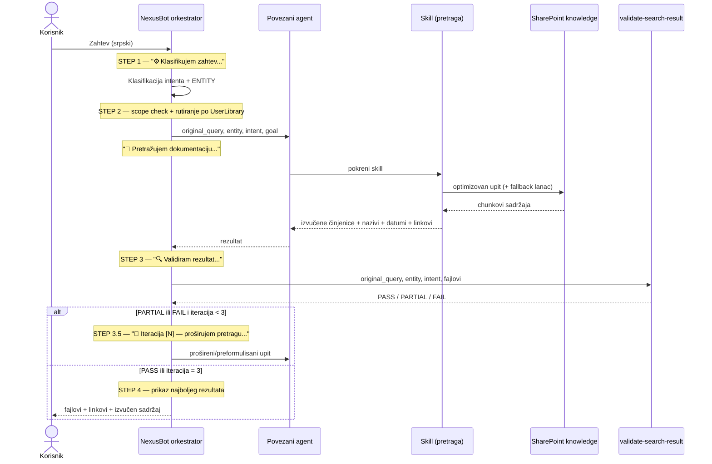
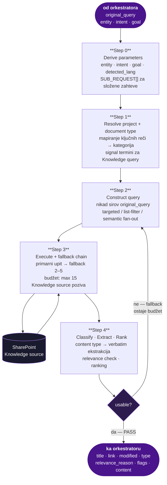

## Tok od upita do odgovora

Jedan zahtev prolazi kroz pet faza orkestratora: klasifikacija (STEP 1), scope + rutiranje (STEP 2), validacija (STEP 3), odluka o ponavljanju (STEP 3.5) i prikaz (STEP 4).

## Sequence dijagram — ceo sistem



## Šta se dešava unutar agenta

Gornji dijagram prikazuje razmenu poruka između komponenti. Ovaj zoom-uje unutar povezanog agenta — pipeline koji se odvija između prijema `original_query` od orkestratora i vraćanja rezultata.



Source: `AGENT_ALFA_ins.txt`; `AGENT_BETA_ins.txt`; `AGENT_DELTA_ins.txt`; `Epsilon-Document-Assistant_ins.txt`; skill fajlovi

## Retry petlja

Posle validacije, orkestrator interno prati broj iteracije (počinje od 1, maksimum 3) i najbolji dosad viđen rezultat (prednost: PASS > PARTIAL > FAIL; realan sadržaj iznad praznog/FALLBACK):

| Verdict | Action |
|---|---|
| PASS | -> Step 4 |
| PARTIAL or FAIL, iteration < 3 | broaden the search and retry ... -> Step 2 |
| iteration = 3 | -> Step 4, using the best result seen across all... |

Source: `nexusbot_orchestrator_system_ins.txt` (STEP 3.5 — RETRY DECISION)

Ako validator vrati grešku ili ništa, to se tretira kao PARTIAL — čime se garantuje bar jedan pokušaj ponavljanja umesto tihog preskakanja validacije:

```
If the skill errors or returns nothing, treat that as PARTIAL — this
ensures a retry is attempted rather than silently skipping validation
```

Source: `nexusbot_orchestrator_system_ins.txt` (STEP 3 — VALIDATE)

Orkestrator nikad ne prikazuje rezultat u kome su svi fajlovi prazni/FALLBACK kao konačan, zadovoljavajući odgovor bez bar jednog pokušaja ponavljanja — osim ako je iteracija već dostigla 3.

Source: `nexusbot_orchestrator_system_ins.txt` (STEP 3.5)

Interne detalje ove logike vidi na [Validacija i retry logika](/orchestrator/validation-and-retry), a sam validator na [validate-search-result](/skills/validate-search-result).
