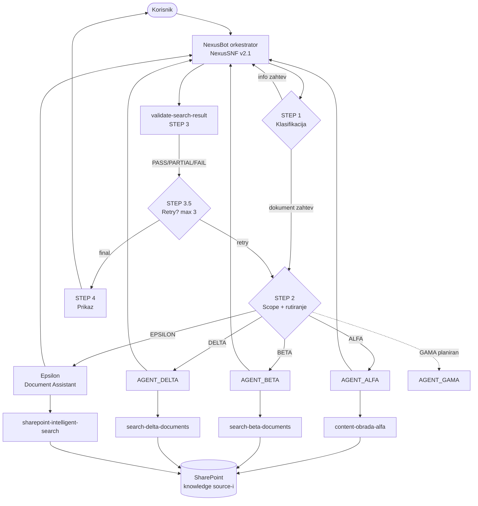

## Komponente

NexusBot je slojevit multi-agent sistem sa jasnom podelom odgovornosti:

| Sloj | Komponenta | Odgovornost |
|---|---|---|
| Orkestracija | NexusBot orkestrator (`NexusSNF v2.1`) | Klasifikacija, rutiranje po odeljenju, validacija, retry, prikaz |
| Delegacija | 4 povezana agenta (+1 planiran) | Domenski specijalisti za pretragu i ekstrakciju |
| Alati | 6 skillova | Konstrukcija upita, ekstrakcija sadržaja, validacija rezultata |
| Znanje | 4 SharePoint biblioteke (+1 planirana) | Izvor stvarnog sadržaja dokumenata |

Source: `_index.md`; `nexusbot_orchestrator_system_ins.txt` (STEP 2); `share_info.txt`

## Dijagram sistema

## Odgovornosti po sloju

**Orkestrator** nikad sam ne pretražuje SharePoint — on odlučuje kome da prosledi zahtev i da li je rezultat dovoljno dobar. Klasifikuje, proverava opseg, delegira, poziva validator, odlučuje o ponavljanju i formatira konačan odgovor. Vidi [Instrukcije orkestratora](/orchestrator/instructions).

**Povezani agenti** su domenski specijalisti. Svaki prima od orkestratora `original_query`, `entity`, `intent` i `goal`, pokreće svoj skill i vraća izvučene činjenice — nikad ne komunicira direktno sa krajnjim korisnikom. Vidi [Povezani agenti](/agents/overview).

**Skillovi** rade težak posao pretrage: grade optimizovan upit (nikad sirov `original_query`), prolaze fallback lanac, klasifikuju sadržaj po tipu i izvlače ga doslovno. Vidi [Skillovi](/skills/overview).

**Knowledge source-i** su četiri SharePoint biblioteke iz kojih se čita stvaran sadržaj. Vidi [Knowledge source-i](/knowledge/sources).

Za detaljan tok jednog zahteva pogledajte [Životni ciklus zahteva](/architecture/data-flow), a za pravila rutiranja [Orkestracija i rutiranje](/architecture/orchestration).