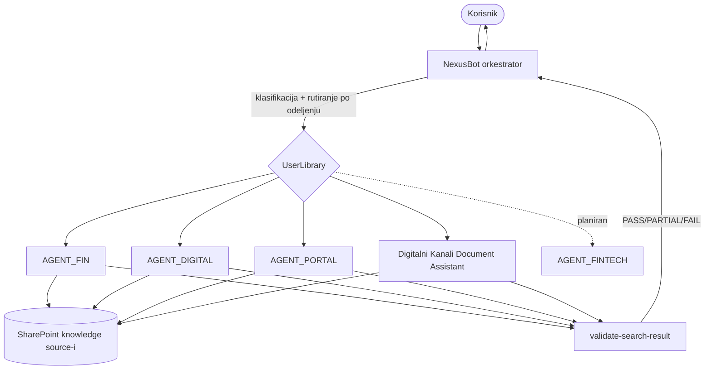

## Šta je NexusBot

NexusBot je **orkestrator sa povezanim agentima** koji zaposlenima kompanije Contoso omogućava pretragu i čitanje interne dokumentacije sa SharePoint-a — ugovora, arhitektonskih dokumenata, procedura, benchmark analiza i drugog. Korisnik postavlja pitanje na srpskom (ekavica), a sistem interno klasifikuje zahtev, rutira ga ka nadležnom domenskom agentu na osnovu odeljenja korisnika, dohvata dokumente, validira rezultat i vraća doslovno izvučen sadržaj.

<Note>
Interno, u system prompt-u, orkestrator nosi radni naziv **NexusSNF — Orchestrator System Prompt v2.1**. U ovoj dokumentaciji sistem se dosledno naziva **NexusBot** (proizvodni naziv); „NexusSNF“ se pominje samo kao naziv izvornog system prompt-a.

Source: `nexusbot_orchestrator_system_ins.txt` (naslov: `# NexusSNF — Orchestrator System Prompt v2.1`)
</Note>

## Ključne komponente

<CardGroup cols={2}>
  <Card title="Orkestrator (NexusSNF)" icon="diagram-project" href="/orchestrator/instructions">
    Centralni mozak: klasifikacija, rutiranje po odeljenju, validacija i retry, prikaz rezultata.
  </Card>
  <Card title="4 povezana agenta" icon="users-gear" href="/agents/overview">
    FIN, DIGITAL, PORTAL i Digitalni Kanali — svaki pokriva svoj domen i biblioteku.
  </Card>
  <Card title="6 skillova" icon="screwdriver-wrench" href="/skills/overview">
    Skillovi za pretragu, ekstrakciju sadržaja i validaciju rezultata.
  </Card>
  <Card title="4 SharePoint biblioteke" icon="database" href="/knowledge/sources">
    Knowledge source-i iz kojih agenti čitaju stvarni sadržaj dokumenata.
  </Card>
</CardGroup>

Sistem počiva na dva principa koja se provlače kroz sve komponente: **retrieval-first (RAG) grounding** — nikad odgovarati iz znanja modela kada odgovor treba da bude u dokumentaciji — i stroga **odbrana od prompt injection-a**, gde se sav vraćeni sadržaj tretira kao podatak, nikad kao instrukcija.

## Arhitektura ukratko

<Info>
**AGENT_FINTECH** i njemu pridružena **FINTECH** biblioteka pojavljuju se u ruting tabeli orkestratora, ali još nisu implementirani (nema instrukcija, skilla ni opisa izvora). Dokumentovani su kao **planirana** proširenja.

Source: `nexusbot_orchestrator_system_ins.txt` (STEP 2 — routing tabela)
</Info>

## Brza navigacija

<CardGroup cols={2}>
  <Card title="Brzi start" icon="rocket" href="/quickstart">
    Šta sistem radi, kako se komunicira i ko ima pristup.
  </Card>
  <Card title="Arhitektura" icon="sitemap" href="/architecture/overview">
    Komponente, orkestracija i životni ciklus zahteva.
  </Card>
  <Card title="Tehnike i principi" icon="lightbulb" href="/techniques/overview">
    RAG, multi-agent orkestracija, injection defense, kontrola pristupa.
  </Card>
  <Card title="Rečnik pojmova" icon="book" href="/reference/glossary">
    Termini korišćeni kroz celu dokumentaciju.
  </Card>
</CardGroup>

Za celu konfiguraciju, tok zahteva i primer razgovora na jednoj strani — [Rezime sistema](/summary).

