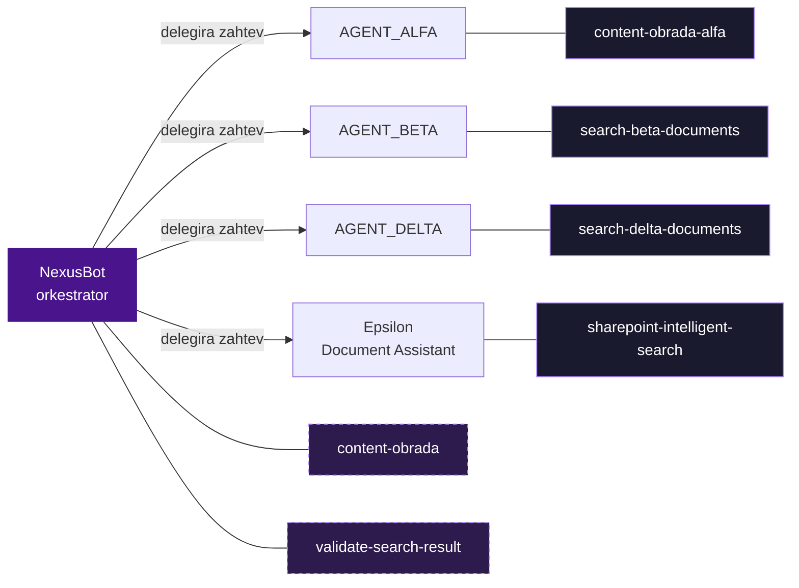

## Svi skillovi

| Skill | Vlasnik | Namena |
|---|---|---|
| [content-obrada](/skills/content-obrada) | NexusBot (orkestrator) | Klasifikacija i ekstrakcija sadržaja (verzija orkestratora) |
| [content-obrada-alfa](/skills/content-obrada-alfa) | AGENT_ALFA | Pretraga + ekstrakcija za ALFA (verzija agenta) |
| [search-beta-documents](/skills/search-beta-documents) | AGENT_BETA | Pretraga Beta dokumentacije |
| [search-delta-documents](/skills/search-delta-documents) | AGENT_DELTA | Pretraga Delta dokumentacije |
| [sharepoint-intelligent-search](/skills/sharepoint-intelligent-search) | Epsilon Document Assistant | Inteligentna SharePoint pretraga (v3.1.0) |
| [validate-search-result](/skills/validate-search-result) | NexusBot (orkestrator) | Ocena kvaliteta rezultata (PASS/PARTIAL/FAIL) |

Source: `_index.md`; pojedinačni skill fajlovi

## Ko poziva koga

Isprekidana linija označava skillove u vlasništvu orkestratora; puna linija označava skillove u vlasništvu domenskog agenta.

## Vlasništvo i dve verzije `content-obrada`

<Info>
`content-obrada` i `content-obrada-alfa` su **dve zasebne verzije** istog koncepta klasifikacije i ekstrakcije sadržaja, a **ne** jedan deljeni skill:

- **NexusBot (orkestrator)** ima svoju verziju: [content-obrada](/skills/content-obrada).
- **AGENT_ALFA** ima svoju verziju: [content-obrada-alfa](/skills/content-obrada-alfa).

Svaka je u vlasništvu svoje komponente i razvija se nezavisno.

Source: `content-obrada-nexus-skill.md`; `content-obrada-alfa-skill.md`; `_index.md`
</Info>

## Podela po ulozi

- **Pretraga + ekstrakcija (po domenu):** `content-obrada-alfa`, `search-beta-documents`, `search-delta-documents`, `sharepoint-intelligent-search` — grade optimizovan upit, prolaze fallback lanac i doslovno izvlače sadržaj. Vidi tehnike [Konstrukcija upita i fallback lanci](/techniques/query-construction-fallback) i [Klasifikacija i ekstrakcija](/techniques/content-classification-extraction).
- **Klasifikacija sadržaja:** `content-obrada` (orkestratorova verzija).
- **Validacija:** `validate-search-result` — jedini skill koji ne pretražuje, već ocenjuje rezultat. Vidi [Validacija + retry petlja](/techniques/validation-retry-loop).
